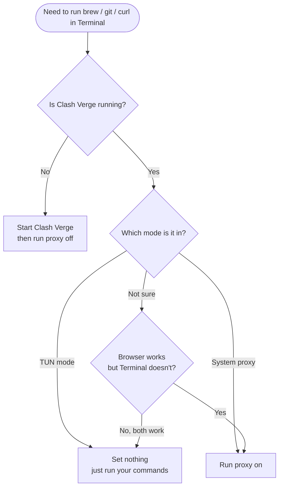

<p align="center">
  <b>English</b> ｜ <a href="README.md">简体中文</a>
</p>

<h1 align="center">Terminal Proxy Toggle Guide</h1>

<p align="center">
  <b>A toggle for your command line: <code>proxy on</code> gets you online, <code>proxy off</code> keeps you online.</b><br>
</p>

<p align="center">
  
  
  
  
</p>

<p align="center">
  <a href="#what-this-guide-solves">The problem</a> ·
  <a href="#quick-start">Quick start</a> ·
  <a href="#3-daily-use-six-scenarios">Six scenarios</a> ·
  <a href="#4-when-it-breaks-verify-and-troubleshoot">Troubleshooting</a> ·
  <a href="#6-cheat-sheet">Cheat sheet</a>
</p>

> [!IMPORTANT]
> **Disclaimer**: This guide is provided for technical learning and discussion only. It explains how to turn proxy environment variables on and off in the macOS terminal. It does **not** provide any proxy service, server, or node, and it does not endorse any unlawful use.
> Follow the laws and regulations that apply to you, along with the terms of service of any network you use. Every example here targets the loopback address `127.0.0.1` only.

---

## What This Guide Solves

If any of these sound familiar, this guide is for you:

- Your browser reaches Google fine, but `brew`, `git clone`, and `curl` hang or fail in Terminal.
- After you turn the proxy off, every network command in Terminal fails with `Connection refused` until you restart the terminal.
- You fly abroad, join the hotel Wi-Fi, the internet clearly works, yet Terminal can't reach anything.
- You pasted a pile of `export http_proxy=...` lines from some blog, forgot about them, and now the setup is a mess.

**The root cause fits in one sentence:**

> Command-line tools ignore the macOS "system proxy" setting. They only read **environment variables** like `http_proxy`.
> And once set, those variables stay in that window, even after Clash is long gone.

So the job isn't "configure a proxy." It's **install a switch you can turn on and off.**

**Never set this up before?** Do the [quick start](#quick-start) in 3 minutes and you'll never think about it again.

---

## Before You Start

### What you need

| Item | Notes |
| --- | --- |
| A Mac | macOS 13 or later; Intel or Apple silicon both fine |
| A proxy client | Examples use **Clash Verge**; ClashX and Mihomo Party work the same way |
| 5 minutes | 3 of them are copy-paste |

> [!NOTE]
> No root access needed, and no system files are touched. Everything lives in your home directory and can be removed at any time (see [Appendix B](#appendix-b-full-removal)).

### Two things to check first

**① Which shell are you using?** Open Terminal (`⌘ + Space`, type "Terminal") and run:

```bash
echo $SHELL
```

| Output | Your shell | Config file |
| --- | --- | --- |
| `/bin/zsh` | zsh (the macOS default) | `~/.zshrc` |
| `/bin/bash` | bash | `~/.bash_profile` |
| anything else (e.g. fish) | not bash or zsh | the script below **won't work as-is**; see [Q7](#q7-im-using-fish-or-windows-what-now) |

> [!TIP]
> This guide uses **zsh** and `~/.zshrc` throughout. On bash, swap every `~/.zshrc` for `~/.bash_profile`. Nothing else changes.

**② What local port is Clash using?** Open Clash Verge → `Settings` → **Mixed Port**.

- The Clash Verge default is **`7897`**. The `7890` you see in older tutorials is the legacy Clash for Windows default, so don't copy it.
- If yours shows a different number, replace `7897` everywhere below with yours.

> [!IMPORTANT]
> Everything below assumes **7897**. If the port is wrong, every command after this point fails, so it's worth a second look.

---

## Quick Start

Just want it working? Four steps.

**Step 1: Open your config file**

```bash
nano ~/.zshrc
```

**Step 2: Paste in the whole script from [Section 2](#2-one-time-setup-install-the-proxy-toggle)**

- Paste: `⌘ + V`
- Save: `Ctrl + O`, then press Enter
- Exit: `Ctrl + X`

**Step 3: Load it**

```bash
source ~/.zshrc
```

**Step 4: Start Clash, then test**

```bash
proxy on
proxy test
```

If you see `HTTP 200` or `HTTP 301`, you're done. When you're finished:

```bash
proxy off
```

That's it. The rest of this guide explains why it works, so come back here when something breaks.

---

## 1. Three Concepts

No networking theory required. Just three terms.

### 1. Environment variables: sticky notes for the command line

Typing `export http_proxy=http://127.0.0.1:7897` in Terminal is like sticking a note on the current window: "for network access, go to 127.0.0.1 port 7897 first."

- The note **only applies to this window**. A new window starts clean.
- The note **never expires on its own**. It survives Clash shutting down, which is exactly why "turning the proxy off" can break everything.
- To peel the note off: `unset http_proxy`.

### 2. System proxy: only well-behaved apps read it

Clash's "System Proxy" switch changes macOS network settings. Apps that bother to read them, such as browsers and WeChat, go through the proxy.

But `brew`, `curl`, `git`, and `docker` **don't read** those settings. They only read the sticky note above.

### 3. TUN mode: takes over at a lower layer

TUN creates a virtual network interface and routes **the whole machine's** traffic through it, command line included.

So in TUN mode you **set nothing at all**. Just run your commands.

### Side by side

| | System proxy | TUN mode |
| --- | --- | --- |
| Scope | Only apps that read system settings (browsers, etc.) | Everything on the machine |
| Does Terminal use it automatically? | ❌ No | ✅ Yes |
| Need `proxy on`? | ✅ Yes | ❌ No (it would just add an extra hop) |
| Stability | Most reliable; works on almost any network | Some hotel and airport networks block what it needs |
| Go-to when troubleshooting | Prefer this one | Switch back to system proxy if TUN won't connect |

### The three-line rule

```text
Browser works, Terminal doesn't   →  system proxy mode  →  proxy on
Both work                         →  TUN mode          →  do nothing
Neither works                     →  Clash is off      →  start Clash
```

### Flowchart



---

## 2. One-Time Setup: Install the `proxy` Toggle

This chapter is a one-time job. After that, it's just `proxy on` and `proxy off`.

### 2.1 Open your config file

```bash
nano ~/.zshrc          # zsh (macOS default)
# or
nano ~/.bash_profile   # bash
```

> [!TIP]
> New to `nano`? It's a plain text editor: `⌘V` pastes, `Ctrl+O` saves (press Enter to confirm), `Ctrl+X` exits.
> Don't edit this file in TextEdit. Its smart quotes will break the script.

### 2.2 Paste the script

Copy this whole block and append it to the end of the file:

```bash
# ==========================================================
#  Clash proxy toggle
#  Usage: proxy on | proxy off | proxy status | proxy test
#  Port:  Clash Verge defaults to 7897; change the line below if yours differs
# ==========================================================
export CLASH_PORT="${CLASH_PORT:-7897}"

proxy() {
  local port="${2:-$CLASH_PORT}"

  case "$1" in
    on)
      # Make sure Clash is actually listening before setting anything
      if ! nc -z 127.0.0.1 "$port" 2>/dev/null; then
        echo "❌ Nothing is listening on 127.0.0.1:${port}"
        echo "   Start Clash Verge, or check Settings → Mixed Port"
        return 1
      fi

      export http_proxy="http://127.0.0.1:${port}"
      export https_proxy="$http_proxy"
      export all_proxy="socks5://127.0.0.1:${port}"
      export HTTP_PROXY="$http_proxy"
      export HTTPS_PROXY="$https_proxy"
      export ALL_PROXY="$all_proxy"
      export NO_PROXY="localhost,127.0.0.1,::1"
      export no_proxy="$NO_PROXY"

      echo "✅ proxy ON  ->  ${http_proxy}"
      ;;

    off)
      unset http_proxy https_proxy all_proxy
      unset HTTP_PROXY HTTPS_PROXY ALL_PROXY
      unset NO_PROXY no_proxy
      echo "✅ proxy OFF (Terminal is direct again)"
      ;;

    status)
      if [ -z "${http_proxy}${https_proxy}${all_proxy}" ]; then
        echo "Current: no proxy variables (direct)"
      else
        echo "Current proxy:"
        env | grep -iE '^(http|https|all|no)_proxy=' | sort
      fi
      ;;

    test)
      echo "Egress test (using current environment variables):"
      curl -sS --max-time 15 -o /dev/null \
        -w "  HTTP %{http_code}  took %{time_total}s\n" \
        https://www.google.com || echo "  ❌ failed"
      ;;

    *)
      echo "Usage:"
      echo "  proxy on                turn the proxy on (default port ${CLASH_PORT})"
      echo "  proxy on 7899           turn it on with a specific port"
      echo "  proxy off               turn it off (back to direct)"
      echo "  proxy status            show the current state"
      echo "  proxy test              test whether you can reach the internet"
      ;;
  esac
}

# Shortcuts (functions rather than aliases, so they also work in scripts and subshells)
proxy_on()  { proxy on "$@"; }
proxy_off() { proxy off; }
```

### 2.3 Load it

```bash
source ~/.zshrc          # or source ~/.bash_profile
```

### 2.4 Verify

Run these in order and compare the output.

**① Right after install, there should be no proxy**

```bash
proxy status
```

```text
Current: no proxy variables (direct)
```

**② Start Clash, then turn the proxy on**

```bash
proxy on
```

```text
✅ proxy ON  ->  http://127.0.0.1:7897
```

If Clash isn't running, you get this instead, and that's the protection working:

```text
❌ Nothing is listening on 127.0.0.1:7897
   Start Clash Verge, or check Settings → Mixed Port
```

**③ Test the exit**

```bash
proxy test
```

```text
  HTTP 200  took 0.83s
```

`200` or `301` both count as working. Direct connections to Google from mainland China won't connect, and that's expected.

**④ Turn it off**

```bash
proxy off
```

```text
✅ proxy OFF (Terminal is direct again)
```

### 2.5 What the script actually does

| Variable | Who reads it | What it does |
| --- | --- | --- |
| `http_proxy` | `curl`, `brew`, `wget`, `git` | Sends plain HTTP requests to the proxy |
| `https_proxy` | same | Sends HTTPS requests (as a `CONNECT` tunnel) |
| `all_proxy` | `curl`, some Go and Python tools | Fallback used when the other two are unset |
| `no_proxy` | all of the above | Exemption list; local addresses bypass the proxy |
| Uppercase versions | some older tools only read uppercase | Compatibility; same values as the lowercase ones |

Three design decisions:

1. **`proxy on` checks the port first.** `nc -z` confirms something is listening on 7897. If Clash is off, no variables are set, which avoids the classic "set it and still can't connect" trap.
2. **`proxy off` clears everything**, including `NO_PROXY`, so nothing is left behind.
3. **No variables are set by default.** After installing, the environment stays clean until you type a command, and traveling abroad is one less thing to think about.

> [!TIP]
> A few tools only understand HTTP proxies and choke on `socks5://`. If you hit one, comment out the two `all_proxy` lines (add `#` in front) and `source` the file again. `http_proxy` and `https_proxy` are enough on their own.

---

## 3. Daily Use: Six Scenarios

Find the one that matches your situation and follow it.

### Scenario A: In China, Clash using system proxy

**The most common setup.** Clash runs with only "System Proxy" on, so your browser gets out.

1. Open Clash Verge → `Settings` → turn on **System Proxy** (TUN can stay off).
2. In Terminal:

   ```bash
   proxy on
   ```

3. Use `brew`, `git`, `curl`, `pip` as usual.
4. When you're done, turn it off:

   ```bash
   proxy off
   ```

**You'll know it worked when:** `proxy status` shows `http_proxy=http://127.0.0.1:7897`.

> [!WARNING]
> Without `proxy on`, Terminal goes direct. On mainland Chinese networks, direct access to GitHub is slow and may fail mid-clone. That's normal, not a broken config.

### Scenario B: In China, Clash using TUN

**The least fuss.** TUN takes over at a lower layer, so Terminal follows along automatically.

1. Clash Verge → `Settings` → turn on **TUN Mode** (system proxy can stay off).
2. In Terminal, **set nothing**. Just confirm:

   ```bash
   proxy status
   ```

   Expected: `Current: no proxy variables (direct)`.

3. Run `brew update` or `git clone` directly.

**You'll know it worked when:** `proxy status` reports no variables, yet `curl -I https://www.google.com` succeeds.

> [!CAUTION]
> If you previously set proxy variables and then switched to TUN, traffic takes two hops (TUN plus the environment variables), which is slower or outright broken. Run `proxy off` before switching to TUN.

### Scenario C: In China, no proxy at all

```bash
proxy off
```

Confirm it's clean:

```bash
env | grep -i proxy
```

**No output** means clean.

**You'll know it worked when:** the command above prints nothing.

> If Clash is off too, `brew` will crawl when it reaches GitHub. That's the network, not your configuration.

### Scenario D: Traveling abroad, connecting directly

**First thing after landing: turn the proxy off.** This is the most overlooked cause of "even the hotel network won't work."

1. In Terminal:

   ```bash
   proxy off
   proxy status
   curl -sS -o /dev/null -w "%{http_code}\n" https://www.google.com
   ```

2. Expected output: `200`.
3. In Clash Verge, **turn off both System Proxy and TUN**. If you won't need it, quit Clash entirely.

**You'll know it worked when:** `proxy status` reports direct, and curl returns `200`.

> [!IMPORTANT]
> Most "the internet doesn't work abroad either" cases are **stale proxy variables pointing at a Clash that isn't running**. Every command gets sent to a port where nobody answers.

### Scenario E: Traveling abroad, still want the proxy

Say you need a fixed US IP to log in to a bank, or you need a service that's only reachable from inside China.

1. Open Clash Verge and pick a suitable profile (HK if you're in Asia, US if you're in the Americas).
2. Turn on System Proxy or TUN.
3. In Terminal:

   ```bash
   proxy on
   ```

4. Be realistic: being abroad and then routing back through Asia or the US will **usually be slower than a direct connection**. Use it only when you need to.
5. `proxy off` when you're done.

**You'll know it worked when:** `proxy test` returns `200` and your exit IP is in the region you wanted.

> [!TIP]
> When traveling, TUN gets blocked on some hotel networks (UDP or unusual protocols get filtered). If TUN won't connect, switch to **system proxy plus `proxy on`**. That path almost always works.

### Scenario F: Hotel and airport login pages (captive portals)

These networks require you to open a web page and log in first. **The proxy blocks that login page**, which looks like "connected to Wi-Fi but nothing loads."

**Correct order:**

```text
1. Clash: turn off TUN, turn off System Proxy
2. Terminal: proxy off
3. Join the Wi-Fi, open a browser, finish the login page
4. Once you're online, turn Clash back on (System Proxy or TUN)
5. Terminal: proxy on (if you're using system proxy)
```

**Symptom to remember:** Wi-Fi shows connected, everything hangs on "Connecting," no page opens. Suspect the proxy first.

**You'll know it worked when:** the login page appears and accepts your credentials.

---

## 4. When It Breaks: Verify and Troubleshoot

### 4.1 Three checks

Run these in order. Thirty seconds tells you which layer is broken.

```bash
# 1. Are proxy variables set right now?
proxy status

# 2. Is the Clash port reachable? (replace 7897 with your port)
nc -z 127.0.0.1 7897 && echo "port open" || echo "port closed"

# 3. Can you actually reach the internet?
curl -sS --max-time 10 -o /dev/null -w "%{http_code}\n" https://www.google.com
```

| ① Variables | ② Port | ③ Internet | Diagnosis | What to do |
| --- | --- | --- | --- | --- |
| set | open | `200` | Everything is fine | Nothing |
| set | closed | error | Variables point at a Clash that isn't running | `proxy off`, or start Clash |
| none | open | fails | Clash is up but Terminal isn't using it | `proxy on` |
| none | closed | fails | Clash is off, or the port isn't 7897 | Start Clash, verify the port |
| none | open | `200` | Direct already works (abroad, or TUN) | Nothing |

### 4.2 Symptom table

| What you see | Most likely cause | Fix |
| --- | --- | --- |
| `Connection refused` | Proxy variables point at a closed Clash | `proxy off`, or start Clash |
| `Could not resolve host` | DNS mangled by the proxy or TUN | `proxy off` and test direct |
| `SSL_ERROR_SYSCALL` / `SSL connect error` | Wrong port, or the proxy doesn't speak that protocol | Verify the port is `7897`, run `proxy test` |
| A command hangs forever | Proxy path is slow or dead | `Ctrl + C`, `proxy off`, retry |
| `brew` is slow but eventually works | Traffic is proxied and the node is slow | Switch Clash nodes, or `proxy off` and go direct |
| Browser works, Terminal doesn't | System proxy mode | `proxy on` |
| Login page won't load | Proxy is blocking the captive portal | See [Scenario F](#scenario-f-hotel-and-airport-login-pages-captive-portals) |
| Commands after `sudo` bypass the proxy | `sudo` wipes the environment | See [Q6](#q6-commands-after-sudo-bypass-the-proxy) |

### 4.3 Reset to a clean state

When the config is a mess or you've lost track of the state, go back to zero:

```bash
proxy off
unset http_proxy https_proxy all_proxy HTTP_PROXY HTTPS_PROXY ALL_PROXY NO_PROXY no_proxy
```

Then **open a new Terminal window** and confirm:

```bash
env | grep -i proxy
```

Empty output means clean.

### 4.4 Still broken? Try these in order

1. **Open a new window.** The old one may still hold variables from an earlier `export`.
2. **Verify the port.** Clash Verge → `Settings` → Mixed Port. Is it really `7897`?
3. **Restart Clash.** After changing the port or config, the client sometimes needs a restart.
4. **Switch to system proxy.** If TUN won't connect, turn TUN off, turn System Proxy on, then `proxy on`.
5. **Try a port explicitly:**

   ```bash
   proxy on 7899        # use the port you actually see in Clash
   proxy test
   ```

### 4.5 System proxy or TUN?

```bash
scutil --proxy
```

| What's in the output | Meaning |
| --- | --- |
| `HTTPProxy : 127.0.0.1` plus `HTTPPort : 7897` | System proxy is active |
| Only `ExceptionsList` and friends, no proxy address | System proxy is off |

> [!NOTE]
> Don't use `ifconfig | grep utun` as a TUN test. macOS creates `utun0`, `utun1`, and so on by itself for features like iCloud Private Relay and Handoff, so seeing `utun` **does not mean** TUN is on.
> The reliable check is the TUN switch in Clash Verge.

---

## 5. Leftover Proxy Settings in Other Tools

`proxy off` only handles environment variables. Some tools **store their own proxy setting** in a config file, so they keep using the proxy even after the environment is clean.

**Self-check** (any output means a setting is stored):

| Tool | Check | Clear |
| --- | --- | --- |
| **git** | `git config --global --get http.proxy`<br>`git config --global --get https.proxy` | `git config --global --unset http.proxy`<br>`git config --global --unset https.proxy` |
| **npm** | `npm config get proxy`<br>`npm config get https-proxy` | `npm config delete proxy`<br>`npm config delete https-proxy` |
| **pip** | `pip config list` | `pip config unset global.proxy` |
| **docker** | `cat ~/.docker/config.json` | Delete the `proxies` field |

Check git and npm in one go:

```bash
git config --global --get http.proxy; git config --global --get https.proxy
npm config get proxy; npm config get https-proxy
```

> [!TIP]
> These leftovers almost always come from "I set this up manually once and forgot." Running this list before a trip saves a lot of puzzling failures.

---

## 6. Cheat Sheet

| What I want to do | Command |
| --- | --- |
| See whether a proxy is set | `proxy status` |
| Turn the proxy on (this window) | `proxy on` |
| Turn it on with a specific port | `proxy on 7899` |
| Turn the proxy off | `proxy off` |
| Test connectivity | `proxy test` |
| Check the Clash port | `nc -z 127.0.0.1 7897 && echo open` |
| Temporarily clear it (this window only) | `unset http_proxy https_proxy all_proxy` |
| List every proxy variable | `env \| grep -i proxy` |
| Check the system proxy state | `scutil --proxy` |

**Four lines to remember everything:**

```text
In China, system proxy  →  proxy on
In China, TUN mode      →  do nothing
Abroad on local Wi-Fi   →  proxy off
Hotel login page        →  off first, on after you're logged in
```

---

## 7. FAQ

### Q1: Why 7897 and not 7890?

`7890` was the default in the old Clash for Windows. Clash Verge's default **mixed port** is `7897`.

If you're unsure, look at Clash Verge → `Settings` → port settings and use what's on screen.

### Q2: After `proxy on`, does my browser stop using the proxy?

No. `proxy on` only changes **the environment variables in the current Terminal window**. It never touches the system proxy.

Whether your browser uses a proxy depends only on the System Proxy and TUN switches inside Clash.

### Q3: Why check the port first? Isn't that overkill?

No. If Clash is off and you set the variables anyway, every later command first tries to reach a port where nobody is listening, so it **hangs or fails with `Connection refused`**. That's worse than having no proxy at all.

`nc -z` checks once, and variables are only set when the port answers.

### Q4: `brew` is still slow after `proxy on`?

Check these in order:

1. **The node itself is slow** → switch nodes.
2. **`brew` is configured to use a domestic mirror**, so the proxy is a detour → check `HOMEBREW_API_DOMAIN`, `HOMEBREW_BOTTLE_DOMAIN`, and similar mirror variables.
3. **git has its own proxy config** → see [Section 5](#5-leftover-proxy-settings-in-other-tools).

### Q5: Do I need to delete all this when I go abroad?

No. This setup sets no variables by default; nothing happens until you type `proxy on`.

Run `proxy off` once after you land and you're back to a direct connection.

### Q6: Commands after `sudo` bypass the proxy?

`sudo` clears the environment by design for security, so the proxy settings disappear.

Pass the variables explicitly for that one command:

```bash
sudo env http_proxy=http://127.0.0.1:7897 https_proxy=http://127.0.0.1:7897 <your command>
```

> [!WARNING]
> Don't edit `/etc/sudoers` just for this. Writing the variables when you need them is safer and easier to undo.

### Q7: I'm using fish or Windows. What now?

- **fish**: the script above is bash syntax and won't run as-is. fish sets variables with `set -gx http_proxy http://127.0.0.1:7897`, so it needs a rewrite.
- **Windows**: not covered here. PowerShell and CMD use completely different variables and commands, so look for a guide written for Windows.

### Q8: Do I need `proxy on` in TUN mode?

No. TUN takes over at the IP layer, so Terminal goes through the proxy automatically.

Setting the variables still works, but it means routing through TUN and then through the variables, which is pointless. Leave it at `proxy off`.

### Q9: What should I watch out for on corporate or school networks?

- The network may **block local proxy ports**, so `proxy on` reports the port as closed.
- It may **require the company's own proxy**, in which case you'd use the address they give you instead.
- Safest approach: `proxy off` and use the network directly. Test `proxy on` separately only if you really need it.

### Q10: How do I know `proxy on` actually worked?

Two commands: one shows the variables, the other shows the result.

```bash
proxy status     # should list http_proxy / https_proxy
proxy test       # should return HTTP 200 or 301
```

---

## Appendix A: One-Off Use

If you don't want to edit any config file, do it by hand in the current window:

```bash
# on
export http_proxy=http://127.0.0.1:7897
export https_proxy=http://127.0.0.1:7897
export all_proxy=socks5://127.0.0.1:7897

# use
brew update

# off (or just close the window)
unset http_proxy https_proxy all_proxy
```

The downside is obvious: it's gone the moment you open a new window, and you have to retype it. If you'll do this more than twice, install the toggle from [Section 2](#2-one-time-setup-install-the-proxy-toggle).

---

## Appendix B: Full Removal

Three steps to leave no trace.

**① Delete the block from your config file**

```bash
nano ~/.zshrc          # or ~/.bash_profile
```

Delete everything from `# ===== Clash proxy toggle =====` through `proxy_off() { ... }`, then `Ctrl+O` to save and `Ctrl+X` to exit.

**② Clean the current window**

```bash
unset http_proxy https_proxy all_proxy HTTP_PROXY HTTPS_PROXY ALL_PROXY NO_PROXY no_proxy
unset -f proxy proxy_on proxy_off 2>/dev/null
```

**③ Open a new window and confirm**

```bash
env | grep -i proxy    # should print nothing
type proxy             # should say not found
```

Once you've done this, your Mac is exactly as it was before you started.

---

## License

Released under the [MIT License](LICENSE): use it, change it, repost it, just keep the attribution.

Found a problem or know a better way? [Open an issue](../../issues/new/choose) or [send a PR](CONTRIBUTING.en.md). Reading [CONTRIBUTING.en.md](CONTRIBUTING.en.md) first saves us both some back-and-forth.

---

<p align="center">
  <sub>Last updated October 2026 · macOS 13+ · Clash Verge / Mihomo · port 7897</sub>
</p>
