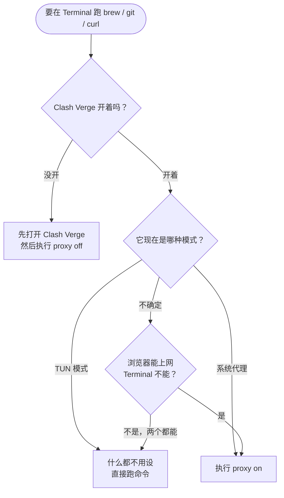

<p align="center">
  <b>简体中文</b> ｜ <a href="README.en.md">English</a>
</p>

<h1 align="center">Terminal 代理开关指南</h1>

<p align="center">
  <b>给命令行装一个开关：<code>proxy on</code> 上网通，<code>proxy off</code> 也通。</b><br>
</p>

<p align="center">
  
  
  
  
</p>

<p align="center">
  <a href="#这份教程解决什么问题">解决什么问题</a> ·
  <a href="#快速开始">快速开始</a> ·
  <a href="#三日常使用六个场景">六个场景</a> ·
  <a href="#四出问题了验证与排错">出问题</a> ·
  <a href="#六速查卡">速查卡</a>
</p>

> [!IMPORTANT]
> **免责声明**：本文档仅供技术学习与交流，讲解 macOS 终端中代理环境变量的开启与关闭，**不提供**任何代理服务、服务器或节点，也不涉及任何违法用途。
>
> 请遵守你所在国家或地区的法律法规，以及所使用网络服务的条款。文中所有示例只指向本机回环地址 `127.0.0.1`。

---

## 这份教程解决什么问题

如果你遇到过下面任意一种情况，这篇就是写给你的：

- 浏览器能打开 Google，但 Terminal 里 `brew`、`git clone`、`curl` 一直转圈或报错；
- 关掉代理后，Terminal 里所有联网命令都报 `Connection refused`，必须重启终端才好；
- 出国换了 Wi-Fi，明明网是通的，Terminal 却上不了网；
- 在网上抄了一堆 `export http_proxy=...`，抄完就忘了，越配越乱。

**根本原因只有一句话**：

> 命令行工具不读 macOS 的「系统代理」设置，它们只看**环境变量**（`http_proxy` 之类）。
> 而环境变量一旦设置，就会一直留在当前窗口里——哪怕 Clash 已经关了。

所以我们要做的不是"配一个代理"，而是**装一个能开能关的开关**。

**没配过？** 花 3 分钟做完[快速开始](#快速开始)，以后就不用再想这件事了。

---

## 开始之前

### 你需要准备

| 项目 | 说明 |
| --- | --- |
| 一台 Mac | macOS 13 及以上都适用（Intel / Apple 芯片均可） |
| 一个代理客户端 | 本文以 **Clash Verge** 为例，ClashX / Mihomo Party 同理 |
| 5 分钟 | 其中 3 分钟只需要复制粘贴 |

> [!NOTE]
> 本文**不需要** root 权限，也**不会**修改系统文件。所有改动都在你自己的用户目录里，随时可以撤掉（见[附录 B](#附录-b彻底移除)）。

### 先确认两件事

**① 你用的是哪个 shell？** 打开「终端」App（`⌘ + 空格` 搜 "Terminal"），输入：

```bash
echo $SHELL
```

| 输出 | 你的 shell | 配置文件 |
| --- | --- | --- |
| `/bin/zsh` | zsh（macOS 默认） | `~/.zshrc` |
| `/bin/bash` | bash | `~/.bash_profile` |
| 其他（如 fish） | 不是 bash/zsh | 本文的脚本**不能**直接用，见 [Q7](#q7我用的是-fish-或-windows怎么办) |

> [!TIP]
> 下文统一以 **zsh** 为例，写 `~/.zshrc`。如果你是 bash，把每一处 `~/.zshrc` 换成 `~/.bash_profile` 即可，其余完全一样。

**② 你的 Clash 本地端口是多少？** 打开 Clash Verge → `设置` → 找到 **混合端口 / Mixed Port**。

- Clash Verge 默认是 **`7897`**（老教程里的 `7890` 是 Clash for Windows 时代的默认值，别照抄）；
- 如果显示的不是 `7897`，把下文所有 `7897` 换成你的端口即可。

> [!IMPORTANT]
> 下文一律按 **7897** 写。端口不对，后面所有命令都会失败——这一步值得多看一眼。

---

## 快速开始

只想赶紧用上？照着做四步。

**第 1 步：打开配置文件**

```bash
nano ~/.zshrc
```

**第 2 步：把[第 2 章](#二一次性配置装上-proxy-开关)那段脚本整段粘贴进去**

- 粘贴：`⌘ + V`
- 保存：`Ctrl + O`，回车
- 退出：`Ctrl + X`

**第 3 步：让它生效**

```bash
source ~/.zshrc
```

**第 4 步：打开 Clash，然后测试**

```bash
proxy on
proxy test
```

看到 `HTTP 200` 或 `HTTP 301` 就成功了。用完之后：

```bash
proxy off
```

完事。下面是原理和细节，遇到问题再回来翻。

---

## 一、三个概念

不需要懂网络原理，只要分清三个词。

### 1. 环境变量：给命令行看的"小纸条"

你在 Terminal 里敲 `export http_proxy=http://127.0.0.1:7897`，等于在当前窗口贴了一张纸条：
"以后联网请先找 127.0.0.1 的 7897 端口"。

- 纸条**只对当前窗口有效**，新开一个窗口就没了；
- 纸条**不会自动过期**，Clash 关了它还在——这就是"关代理后反而全断"的原因；
- 撕掉纸条的办法：`unset http_proxy`。

### 2. 系统代理：只影响"乖孩子"App

Clash 的「系统代理」开关改的是 macOS 的网络设置。浏览器、微信这类 App 会主动去读，所以它们能上网。

但 `brew`、`curl`、`git`、`docker` 这些命令行工具**不读**这个设置——它们只认上面那张纸条。

### 3. TUN 模式：在更底层接管一切

TUN 会在系统里建一块"虚拟网卡"，把**整台电脑**的流量都揽过来，包括命令行。

所以在 TUN 模式下，你**什么都不用设**，直接跑命令就行。

### 一张表看懂

| | 系统代理（System Proxy） | TUN 模式 |
| --- | --- | --- |
| 作用范围 | 只有主动读系统设置的 App（浏览器等） | 整台电脑，所有程序 |
| Terminal 会自动走代理吗 | ❌ 不会 | ✅ 会 |
| 需要 `proxy on` 吗 | ✅ 需要 | ❌ 不需要（设了等于多绕一层） |
| 稳定性 | 最稳，几乎所有网络都能用 | 部分酒店 / 机场网络会拦截特殊协议 |
| 出问题时的第一选择 | 优先用它 | 连不上就切回系统代理 |

### 判断口诀

```text
浏览器能上、Terminal 不能上   →  系统代理模式  →  proxy on
浏览器和 Terminal 都能上      →  TUN 模式      →  什么都不用做
两个都不能上                  →  Clash 没开    →  先开 Clash
```

### 流程图



---

## 二、一次性配置：装上 proxy 开关

这一章只做一次，以后每天只需要敲 `proxy on` / `proxy off`。

### 2.1 打开配置文件

```bash
nano ~/.zshrc          # zsh（macOS 默认）
# 或者
nano ~/.bash_profile   # bash
```

> [!TIP]
> 第一次用 `nano` 的人常卡在这里：它是个纯文本编辑器，`⌘V` 粘贴，`Ctrl+O` 保存（回车确认），`Ctrl+X` 退出。
> 别用「文本编辑」App 改这个文件——它可能加进智能引号，把脚本弄坏。

### 2.2 整段粘贴进去

复制下面这一整块，粘贴到文件末尾：

```bash
# ==========================================================
#  Clash 代理开关
#  用法：proxy on | proxy off | proxy status | proxy test
#  端口：Clash Verge 默认 7897，不是这个就改下面这行
# ==========================================================
export CLASH_PORT="${CLASH_PORT:-7897}"

proxy() {
  local port="${2:-$CLASH_PORT}"

  case "$1" in
    on)
      # 先确认 Clash 真的在监听，避免设了变量却连不上
      if ! nc -z 127.0.0.1 "$port" 2>/dev/null; then
        echo "❌ Clash 没有在 127.0.0.1:${port} 监听"
        echo "   请先打开 Clash Verge，或检查「设置 → 混合端口」"
        return 1
      fi

      export http_proxy="http://127.0.0.1:${port}"
      export https_proxy="$http_proxy"
      export all_proxy="socks5://127.0.0.1:${port}"
      export HTTP_PROXY="$http_proxy"
      export HTTPS_PROXY="$https_proxy"
      export ALL_PROXY="$all_proxy"
      export NO_PROXY="localhost,127.0.0.1,::1"
      export no_proxy="$NO_PROXY"

      echo "✅ proxy ON  ->  ${http_proxy}"
      ;;

    off)
      unset http_proxy https_proxy all_proxy
      unset HTTP_PROXY HTTPS_PROXY ALL_PROXY
      unset NO_PROXY no_proxy
      echo "✅ proxy OFF（Terminal 直连）"
      ;;

    status)
      if [ -z "${http_proxy}${https_proxy}${all_proxy}" ]; then
        echo "当前：无代理变量（直连）"
      else
        echo "当前代理："
        env | grep -iE '^(http|https|all|no)_proxy=' | sort
      fi
      ;;

    test)
      echo "出口测试（走当前环境变量）："
      curl -sS --max-time 15 -o /dev/null \
        -w "  HTTP %{http_code}  耗时 %{time_total}s\n" \
        https://www.google.com || echo "  ❌ 失败"
      ;;

    *)
      echo "用法："
      echo "  proxy on                开启代理（默认端口 ${CLASH_PORT}）"
      echo "  proxy on 7899           开启代理（临时指定端口）"
      echo "  proxy off               关闭代理（回到直连）"
      echo "  proxy status            查看当前状态"
      echo "  proxy test              测试能不能上网"
      ;;
  esac
}

# 便捷写法（用函数而非 alias，在脚本、子 shell 里也有效）
proxy_on()  { proxy on "$@"; }
proxy_off() { proxy off; }
```

### 2.3 让它生效

```bash
source ~/.zshrc          # 或者 source ~/.bash_profile
```

### 2.4 验证

依次执行，对照输出：

**① 刚装好，应该是"没有代理"**

```bash
proxy status
```

```text
当前：无代理变量（直连）
```

**② 打开 Clash，再开代理**

```bash
proxy on
```

```text
✅ proxy ON  ->  http://127.0.0.1:7897
```

如果 Clash 没开，会得到（这正是我们要的保护）：

```text
❌ Clash 没有在 127.0.0.1:7897 监听
   请先打开 Clash Verge，或检查「设置 → 混合端口」
```

**③ 测试出口**

```bash
proxy test
```

```text
  HTTP 200  耗时 0.83s
```

`200` 或 `301` 都算通。国内直连 Google 打不开是正常的。

**④ 关掉**

```bash
proxy off
```

```text
✅ proxy OFF（Terminal 直连）
```

### 2.5 这段脚本在做什么

| 变量 | 谁在用 | 作用 |
| --- | --- | --- |
| `http_proxy` | `curl`、`brew`、`wget`、`git` | 明文 HTTP 请求发给代理 |
| `https_proxy` | 同上 | HTTPS 请求（`CONNECT` 隧道）发给代理 |
| `all_proxy` | `curl`、部分 Go/Python 工具 | 兜底，覆盖上面两个没设的情况 |
| `no_proxy` | 以上全部 | 例外名单，本地地址不走代理 |
| 大写版本 | 一些老工具只认大写 | 兼容用，值和小写相同 |

三个设计要点：

1. **`proxy on` 先探端口**：`nc -z` 检查 7897 有没有人监听。没开 Clash 就不设变量，避免"设了却连不上"的经典坑。
2. **`proxy off` 是彻底清空**：连 `NO_PROXY` 也一起 `unset`，不留残留。
3. **默认不设任何变量**：装完不敲命令，环境就是干净的，出国也不用手忙脚乱。

> [!TIP]
> 极少数工具只认 HTTP 代理、不认 `socks5://`，会报奇怪的错。真遇到了，把脚本里 `all_proxy` 那两行注释掉（前面加 `#`）再 `source` 一次即可，`http_proxy` / `https_proxy` 已经够用。

---

## 三、日常使用：六个场景

按你的处境找到对应的一条，照着做即可。

### 场景 A：国内，Clash 用系统代理

**最常用的场景。** 平时 Clash 只开着「系统代理」，让浏览器翻墙。

1. 打开 Clash Verge → `设置` → **系统代理** 打开（TUN 可以关掉）。
2. Terminal 里：

   ```bash
   proxy on
   ```

3. 正常使用 `brew`、`git`、`curl`、`pip`。
4. 用完记得关：

   ```bash
   proxy off
   ```

**完成标志**：`proxy status` 显示 `http_proxy=http://127.0.0.1:7897`。

> [!WARNING]
> 不开 `proxy on` 时，Terminal 是直连的。国内网络直连 GitHub 会很慢，甚至 clone 到一半失败——这是正常的，不是配置坏了。

### 场景 B：国内，Clash 用 TUN

**最省事的场景。** TUN 会在底层接管，Terminal 自动走代理。

1. Clash Verge → `设置` → **TUN 模式** 打开（系统代理可关）。
2. Terminal 里**什么都不用设**，只确认一下：

   ```bash
   proxy status
   ```

   期望：`当前：无代理变量（直连）`。

3. 直接跑 `brew update`、`git clone`。

**完成标志**：`proxy status` 显示无代理变量，但 `curl -I https://www.google.com` 能通。

> [!CAUTION]
> 如果你之前设过代理变量又切到 TUN，流量会"TUN 绕一层 + 环境变量再绕一层"，反而变慢或报错。切 TUN 前先 `proxy off`。

### 场景 C：国内，完全不用代理

```bash
proxy off
```

确认干净：

```bash
env | grep -i proxy
```

**输出空白** = 干净。

**完成标志**：上一条命令什么都不打印。

> 此时 Clash 也关着的话，`brew` 访问 GitHub 会慢，那是网络本身的问题，跟本文的配置无关。

### 场景 D：出国旅游，用当地 Wi-Fi 直连

**落地第一件事，先关代理。** 这是最容易被忽略、也最容易让人以为"国外网也上不去"的原因。

1. Terminal：

   ```bash
   proxy off
   proxy status
   curl -sS -o /dev/null -w "%{http_code}\n" https://www.google.com
   ```

2. 期望输出：`200`。
3. Clash Verge 里**关掉系统代理和 TUN**；用不上就干脆退出 Clash。

**完成标志**：`proxy status` 显示直连，且 curl 返回 `200`。

> [!IMPORTANT]
> 很多"在国外也上不了网"的情况，真凶是**残留的代理变量指向了已经关掉的 Clash**——命令全部被送进一个不存在的端口。

### 场景 E：出国旅游，但仍需要代理

比如：要固定某个国家的 IP 登录银行、或访问只有国内能用的服务。

1. 打开 Clash Verge，选合适的节点（在亚洲优先 HK，在美洲优先 US）。
2. 开「系统代理」或「TUN」。
3. Terminal：

   ```bash
   proxy on
   ```

4. 心里有数：人在国外再绕回亚洲/美国，速度**大概率不如直连**，能接受再用。
5. 用完 `proxy off`。

**完成标志**：`proxy test` 返回 `200`，且出口 IP 符合你要的地区。

> [!TIP]
> 跨境旅游时，TUN 在部分酒店网络会被限制（UDP 或特殊协议被拦）。TUN 连不上就改用 **系统代理 + `proxy on`**，这条路几乎总能走通。

### 场景 F：酒店 / 机场的登录页

这类网络（Captive Portal）要求你先打开一个网页登录，**代理会把这个登录页挡住**，表现就是"连上了 Wi-Fi 但打不开任何网页"。

**正确顺序**：

```text
1. Clash：关闭 TUN，关闭系统代理
2. Terminal：proxy off
3. 连 Wi-Fi，打开浏览器，完成登录页
4. 登录成功后，再打开 Clash（系统代理或 TUN）
5. Terminal：proxy on（如果你用的是系统代理）
```

**症状对照**：连上 Wi-Fi 后一直"正在连接"、所有网页都打不开 → 先怀疑代理没关。

**完成标志**：登录页能正常弹出并完成认证。

---

## 四、出问题了：验证与排错

### 4.1 三步体检

按顺序敲，30 秒定位问题在哪一层：

```bash
# ① 现在有没有代理变量？
proxy status

# ② Clash 端口通不通？（把 7897 换成你的端口）
nc -z 127.0.0.1 7897 && echo "端口通" || echo "端口不通"

# ③ 实际能不能上网？
curl -sS --max-time 10 -o /dev/null -w "%{http_code}\n" https://www.google.com
```

| ① 变量 | ② 端口 | ③ 上网 | 结论 | 怎么办 |
| --- | --- | --- | --- | --- |
| 有 | 通 | `200` | 一切正常 | 无需处理 |
| 有 | 不通 | 报错 | 变量指向了没开的 Clash | `proxy off`，或先开 Clash |
| 无 | 通 | 打不开 | Clash 开着但 Terminal 没走 | `proxy on` |
| 无 | 不通 | 打不开 | Clash 没开，或端口不是 7897 | 开 Clash，核对端口 |
| 无 | 通 | `200` | 直连就通（可能在国外 / 已开 TUN） | 什么都不用做 |

### 4.2 症状对照表

| 你看到的报错 / 现象 | 最可能的原因 | 处理 |
| --- | --- | --- |
| `Connection refused` | 代理变量指向已关闭的 Clash | `proxy off`，或先开 Clash |
| `Could not resolve host` | DNS 被代理或 TUN 影响 | 先 `proxy off` 测直连 |
| `SSL_ERROR_SYSCALL` / `SSL connect error` | 端口写错，或代理不支持该协议 | 核对端口 `7897`，跑 `proxy test` |
| 命令一直卡住不返回 | 代理链路慢或已断 | `Ctrl + C`，`proxy off` 后重试 |
| `brew` 很慢但最终能通 | 走代理了，但节点慢 | 换 Clash 节点；或 `proxy off` 走直连 |
| 浏览器能上、Terminal 不能 | 系统代理模式 | `proxy on` |
| 登录页打不开 / 一直转圈 | 代理挡住了 Captive Portal | 见[场景 F](#场景-f酒店--机场的登录页) |
| `sudo` 之后的命令不走代理 | `sudo` 默认清空环境变量 | 见 [Q6](#q6sudo-开头的命令不走代理怎么办) |

### 4.3 一键回到干净状态

配置乱了、状态不明时，先归零再重来：

```bash
proxy off
unset http_proxy https_proxy all_proxy HTTP_PROXY HTTPS_PROXY ALL_PROXY NO_PROXY no_proxy
```

然后**新开一个 Terminal 窗口**，确认：

```bash
env | grep -i proxy
```

空白即干净。

### 4.4 还是不行？按这个顺序试

1. **新开一个窗口**：旧窗口里可能还残留着早先 `export` 的变量。
2. **核对端口**：Clash Verge → `设置` → 混合端口，是不是真的 `7897`。
3. **重启 Clash**：改过端口或配置后，客户端有时需要重启才生效。
4. **换系统代理试**：TUN 连不上 → 关 TUN、开系统代理 → `proxy on`。
5. **临时指定端口验证**：

   ```bash
   proxy on 7899        # 换成你在 Clash 里看到的端口
   proxy test
   ```

### 4.5 怎么确认当前是「系统代理」还是「TUN」

```bash
scutil --proxy
```

| 输出里有什么 | 说明 |
| --- | --- |
| `HTTPProxy : 127.0.0.1` + `HTTPPort : 7897` | 系统代理已生效 |
| 只有 `ExceptionsList` 等，没有代理地址 | 系统代理关闭 |

> [!NOTE]
> 别用 `ifconfig | grep utun` 来判断 TUN。macOS 自己就会创建 `utun0`、`utun1`… 这些网卡（iCloud 私密中继、接力等功能都在用），看到 `utun` **不代表**开了 TUN。
>
> 最可靠的判断：去看 Clash Verge 里 TUN 那个开关的状态。

---

## 五、其他工具的代理残留

`proxy off` 只管环境变量。但有些工具**自己存了一份代理配置**在配置文件里，环境变量清空了它们照样走代理。

**自查清单**（有输出就说明存了）：

| 工具 | 检查 | 清除 |
| --- | --- | --- |
| **git** | `git config --global --get http.proxy`<br>`git config --global --get https.proxy` | `git config --global --unset http.proxy`<br>`git config --global --unset https.proxy` |
| **npm** | `npm config get proxy`<br>`npm config get https-proxy` | `npm config delete proxy`<br>`npm config delete https-proxy` |
| **pip** | `pip config list` | `pip config unset global.proxy` |
| **docker** | `cat ~/.docker/config.json` | 删除文件里的 `proxies` 字段 |

一次跑完 git 和 npm 的检查：

```bash
git config --global --get http.proxy; git config --global --get https.proxy
npm config get proxy; npm config get https-proxy
```

> [!TIP]
> 这些残留最常见于"以前手动配过一次，后来忘了"的情况。出国前跑一遍这个清单，能省掉很多莫名其妙的故障。

---

## 六、速查卡

| 我想做的事 | 命令 |
| --- | --- |
| 看现在有没有代理 | `proxy status` |
| 开代理（当前窗口） | `proxy on` |
| 开代理（指定端口） | `proxy on 7899` |
| 关代理 | `proxy off` |
| 测试能不能上网 | `proxy test` |
| 检查 Clash 端口 | `nc -z 127.0.0.1 7897 && echo 通` |
| 临时关掉（只影响当前窗口） | `unset http_proxy https_proxy all_proxy` |
| 看所有代理变量 | `env \| grep -i proxy` |
| 看系统代理状态 | `scutil --proxy` |

**四句话记住全部**：

```text
国内用系统代理  →  proxy on
国内用 TUN      →  不用管
出国用当地网    →  proxy off
酒店登录页      →  先 off，登录后再 on
```

---

## 七、常见问题

### Q1：为什么是 7897，不是 7890？

`7890` 是旧版 Clash for Windows 的默认值。Clash Verge 的默认**混合端口**是 `7897`。

不确定就看 Clash Verge → `设置` → 端口设置，以界面显示的为准。

### Q2：`proxy on` 之后，浏览器反而不走代理了？

不会。`proxy on` 只改**当前 Terminal 窗口的环境变量**，完全不碰系统代理。

浏览器走不走代理，只取决于 Clash 里的「系统代理 / TUN」开关。

### Q3：为什么要在脚本里先检查端口？多此一举吗？

不多余。如果 Clash 没开却设了变量，之后每条命令都会先尝试连一个不存在的端口，结果是**卡住或报 `Connection refused`**——比不设代理还糟。

`nc -z` 检查一次，只在端口通的时候才设变量。

### Q4：`proxy on` 之后 `brew` 还是慢？

按这个顺序查：

1. **节点本身慢** → 换节点；
2. **`brew` 在用国内镜像**，走代理反而绕远 → 检查 `HOMEBREW_API_DOMAIN`、`HOMEBREW_BOTTLE_DOMAIN` 等镜像变量；
3. **git 里有自己的代理配置** → 见[第 5 章](#五其他工具的代理残留)。

### Q5：出国后需要把配置删掉吗？

不需要。这套配置默认不设任何变量，只有你敲 `proxy on` 才生效。

落地后执行一次 `proxy off` 就回到直连状态。

### Q6：`sudo` 开头的命令不走代理怎么办？

`sudo` 默认会清空环境变量（安全设计），所以代理"丢"了。

临时把变量显式传进去：

```bash
sudo env http_proxy=http://127.0.0.1:7897 https_proxy=http://127.0.0.1:7897 <你的命令>
```

> [!WARNING]
> 不建议为这件事去改 `/etc/sudoers`。用一次就写一次变量，更安全也更容易回滚。

### Q7：我用的是 fish 或 Windows，怎么办？

- **fish**：上面那段是 bash 语法，不能直接用。fish 的环境变量写法是 `set -gx http_proxy http://127.0.0.1:7897`，需要改写。
- **Windows**：本文不适用。PowerShell / CMD 的变量与命令完全不同，请另找对应教程。

### Q8：TUN 模式下还要 `proxy on` 吗？

不需要。TUN 在 IP 层接管所有流量，Terminal 自动走代理。

设了变量也能用，但那是"TUN 绕一层 + 变量再绕一层"，属于多此一举，建议保持 `proxy off`。

### Q9：在公司 / 学校网络要注意什么？

- 公司网络可能**封掉本地代理端口** → `proxy on` 会报端口不通；
- 也可能**要求走公司自己的代理** → 那就得把端口换成公司给的地址；
- 最稳的做法：先 `proxy off`，用公司网络直连；确实需要时再单独 `proxy on` 测试。

### Q10：怎么知道 `proxy on` 真的生效了？

两条命令，一条看变量、一条看结果：

```bash
proxy status     # 应该列出 http_proxy / https_proxy
proxy test       # 应该返回 HTTP 200 或 301
```

---

## 附录 A：只想临时用一次

不想改任何配置文件，就在当前窗口手动来一次：

```bash
# 开
export http_proxy=http://127.0.0.1:7897
export https_proxy=http://127.0.0.1:7897
export all_proxy=socks5://127.0.0.1:7897

# 用
brew update

# 关（或者直接关掉这个窗口）
unset http_proxy https_proxy all_proxy
```

缺点很明显：新开窗口就失效，还得重新敲一遍。用超过两次，就去装[第 2 章](#二一次性配置装上-proxy-开关)那个开关。

---

## 附录 B：彻底移除

不想用了，删干净只需要三步。

**① 从配置文件里删掉那段**

```bash
nano ~/.zshrc          # 或 ~/.bash_profile
```

把 `# ===== Clash 代理开关 =====` 到 `proxy_off() { ... }` 之间的内容整段删除，`Ctrl+O` 保存，`Ctrl+X` 退出。

**② 清掉当前窗口的残留**

```bash
unset http_proxy https_proxy all_proxy HTTP_PROXY HTTPS_PROXY ALL_PROXY NO_PROXY no_proxy
unset -f proxy proxy_on proxy_off 2>/dev/null
```

**③ 新开一个窗口确认**

```bash
env | grep -i proxy    # 应该没有输出
type proxy             # 应该提示 not found
```

删掉之后，你的 Mac 和装之前没有任何区别。

---

## 许可证

本项目以 [MIT](LICENSE) 协议开源：随便用、随便改、随便转载，保留出处即可。

发现问题或有更好的做法，欢迎[提 Issue](../../issues/new/choose) 或 [提 PR](CONTRIBUTING.md)；提之前请看一眼 [CONTRIBUTING.md](CONTRIBUTING.md)，能省不少来回。

---

<p align="center">
  <sub>最后更新 2026-10 · 适用 macOS 13+ · Clash Verge / Mihomo · 端口 7897</sub>
</p>
